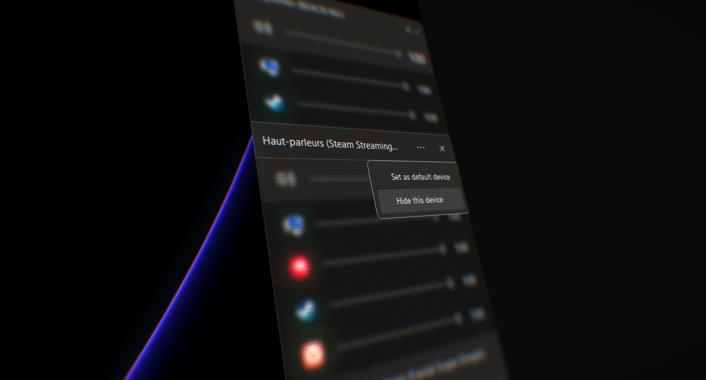
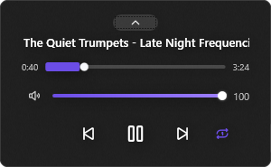
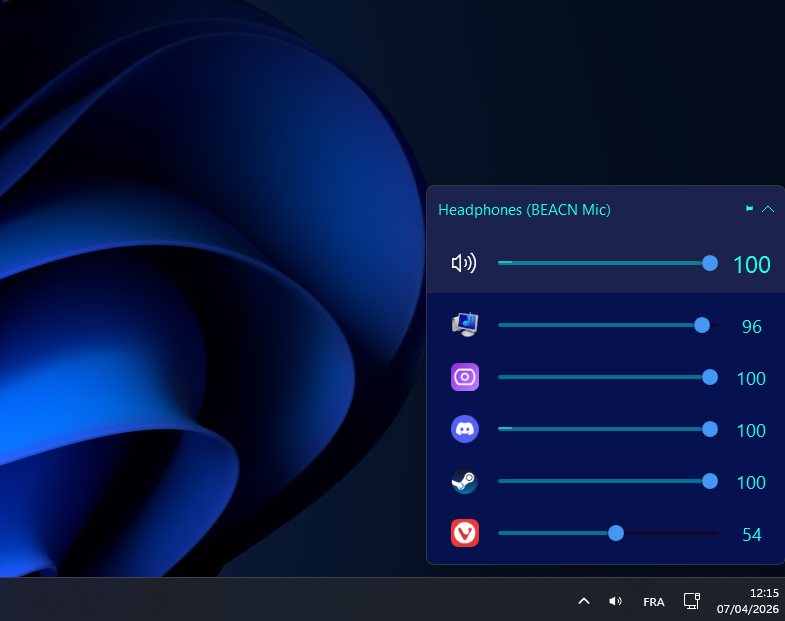
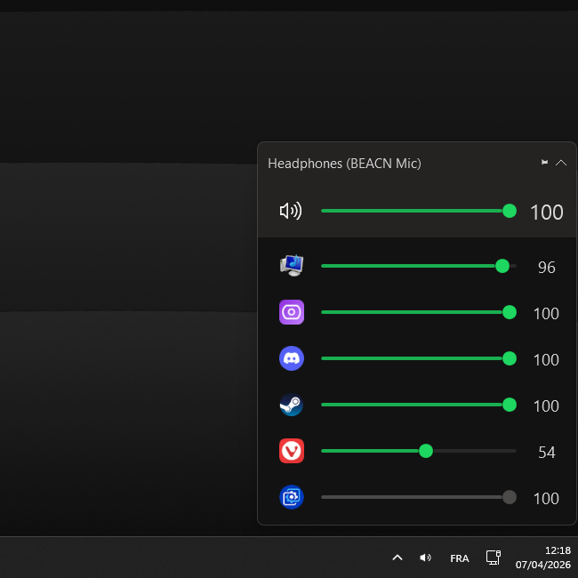
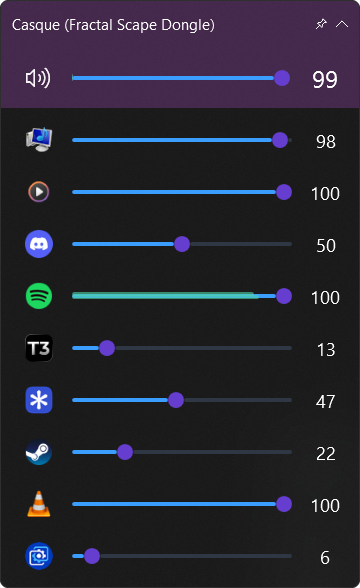
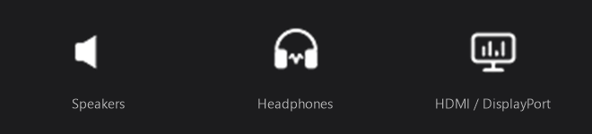

<p align="center">
  <code>♬⋆.˚ ✩°｡⋆⸜ 🎺 ⸝⋆｡°✩ ˚.⋆♬</code>
</p>

<h1 align="center">BetterTrumpet</h1>

<p align="center">
  <a href="https://bettertrumpet.com">
    
  </a>
  <a href="https://github.com/xammen/BetterTrumpet/releases/latest">
    
  </a>
  <a href="https://www.reddit.com/r/BetterTrumpet/">
    
  </a>
</p>

<p align="center">
  <i>Per-app volume control for Windows that actually feels good to use.</i><br/>
  <i>A polished fork of EarTrumpet, with app rules, presets, a media popup, themes and a CLI.</i>
</p>

<p align="center">
  
</p>

<p align="center">
  <a href="#install">Install</a> ·
  <a href="#features">Features</a> ·
  <a href="#cli">CLI</a> ·
  <a href="#privacy">Privacy</a> ·
  <a href="#build-from-source">Build</a> ·
  <a href="#community">Community</a>
</p>

---

## Why BetterTrumpet

The Windows volume mixer is two clicks too deep and forgets everything. BetterTrumpet lives in the tray and keeps it simple:

- **Every app, one click away.** Click the tray icon, drag a slider, done.
- **It remembers.** Start Discord at 50%, keep that one game muted, lock an app's volume so it stops creeping up.
- **One click setups.** Save "work", "gaming" or "night" as presets: output device, mic, device and app volumes, all at once.
- **Your media, on hover.** Hover the tray icon to control what's playing.
- **Looks the part.** Fits Windows 10 and 11, with themes if you want something else.

It started as a fork of [EarTrumpet](https://github.com/File-New-Project/EarTrumpet) and keeps what made it great.

## Install

| Method | Command / link |
| --- | --- |
| **Installer or portable zip** | [GitHub Releases](https://github.com/xammen/BetterTrumpet/releases/latest) |
| **Winget** | `winget install --id xmn.BetterTrumpet` |
| **Chocolatey** | `choco install bettertrumpet` |

Requires Windows 10 (1809 or later) or Windows 11. The settings window uses the Microsoft Edge WebView2 runtime, which ships with Windows 11 and up-to-date Windows 10.

> **Windows Defender or SmartScreen complaining?** The builds aren't code-signed yet, so new releases sometimes trip a machine-learning heuristic (a false positive). Each release ships a `release-checksums-X.Y.Z.txt` so you can check the SHA-256 of what you downloaded. Signing is on the roadmap.

## Features

### Per-app volume, done right

<p align="center">
  
</p>

- Every playing app gets its own slider, grouped by output device.
- Send an app to a specific output (game on the headset, music on the speakers).
- Hide the apps and devices you never touch.
- `Ctrl+click` an app to solo it, `Ctrl+Z` / `Ctrl+Y` to undo and redo volume changes, `Ctrl+P` to pin the flyout open.
- Global shortcuts for the flyout, the mixer, volume up/down and switching devices, plus one shortcut per device.

### App rules

Rules follow an app across restarts and reboots:

- **Set at launch:** the app always starts at the volume you chose.
- **Lock:** the volume stays put, whatever the app tries.
- **Keep muted:** muted every time it makes a sound.
- **Folder defaults:** a starting volume for everything installed in a folder (handy for game libraries).
- **Focus-lost:** quietly lower apps when you switch away from them, with a fade.

### QuickTrumpet presets

Save the current setup and bring it back in one click, from a hotkey or from the CLI. A preset can switch your default output and microphone, set device volumes and set app volumes, in any combination. Cycle through your presets with the next/previous shortcuts.

### Media popup

<p align="center">
  
</p>

Hover the tray icon to see what's playing: play/pause, skip, seek, shuffle, repeat and the app's own volume. Expand it to show the cover art.

### Make it yours

<div align="center">
  <table>
    <tr>
      <td align="center">
        
        <br />
        <sub>Default: follows your Windows accent</sub>
      </td>
      <td align="center">
        
        <br />
        <sub>Spotify</sub>
      </td>
      <td align="center">
        
        <br />
        <sub>Your own colors</sub>
      </td>
    </tr>
  </table>
</div>

- 12 built-in themes (Discord, Nord, Dracula, Catppuccin, high contrast and more), or pick your own seven colors.
- Window opacity, peak meter styles, and an album-art mode that tints the sliders with the cover of what's playing.
- An eco mode that lowers refresh rates, always or only on battery.

### A tray icon that tells you where the sound goes

<p align="center">
  
</p>

Optional: the tray icon can show the kind of output you're on (speakers, headphones or a monitor) and animates while something plays. *Coming in the next release.*

### Settings

A modern settings window with search: type "mute" or "startup" and jump straight to the right option. The classic window is still there if you prefer it.

## CLI

BetterTrumpet comes with a `bt` command (the installer can add it to your PATH). It talks to the running app and answers in JSON, so it's easy to script.

```powershell
bt help                          # everything it can do
bt volume discord 40             # set an app's volume
bt toggle-mute spotify
bt set-default "Headphones"      # switch the default output
bt save gaming                   # save the current setup as a preset
bt gaming                        # ...and apply it later
bt preset next                   # cycle through presets
bt doctor                        # quick health check
```

The full reference lives in [docs/CLI.md](docs/CLI.md).

## Privacy

- **Diagnostic data** (one switch, off by default in the EU, on elsewhere): an anonymous ping at startup and crash reports through Sentry. No personal data is attached and nothing is sold. Change it anytime in Settings → Privacy.
- **Update checks** ask the GitHub API for the latest release. They're a separate switch.
- **The "What's new" feed** (news and polls) can be turned off in Settings → Privacy. Votes are anonymous.
- **Diagnostic exports** are zip files you create yourself and review before sharing. Nothing is uploaded automatically.

Details in [PRIVACY.md](PRIVACY.md).

## Build from source

You need the .NET 8 SDK and Node.js (npm builds the settings UI during the build). The app is x86.

```powershell
git clone https://github.com/xammen/BetterTrumpet
cd BetterTrumpet
dotnet build EarTrumpet\EarTrumpet.csproj -c Release -r win-x86 --self-contained -p:Platform=x86 -p:OutputPath="..\Build\Release"
```

The app lands in `Build\Release\BetterTrumpet.exe`. `build-portable.ps1` makes the portable zip, and `installer.iss` builds the installer with [Inno Setup 6](https://jrsoftware.org/isinfo.php).

| Area | Stack |
| --- | --- |
| App | C# / WPF on .NET 8 |
| Audio | Windows Core Audio, Windows media sessions |
| Settings | React + Fluent UI in WebView2 |
| CLI | Named pipe to the running app |
| Packaging | GitVersion, Inno Setup, portable zip, Winget, Chocolatey |

## Community

- [GitHub Issues](https://github.com/xammen/BetterTrumpet/issues) for bugs and feature requests
- [r/BetterTrumpet](https://www.reddit.com/r/BetterTrumpet/) to chat, share setups and give feedback

## Credits

Built on [EarTrumpet](https://github.com/File-New-Project/EarTrumpet) by David Golden, Rafael Rivera and Dave Amenta.

## License

[MIT](./LICENSE)

<p align="center">
  <br/>
  <code>♬⋆.˚ ✩°｡⋆⸜ 🎺 ⸝⋆｡°✩ ˚.⋆♬</code>
  <br/>
  <br/>
  <i>made with volume ˚ʚ♡ɞ˚</i>
  <br/>
  <br/>
</p>
